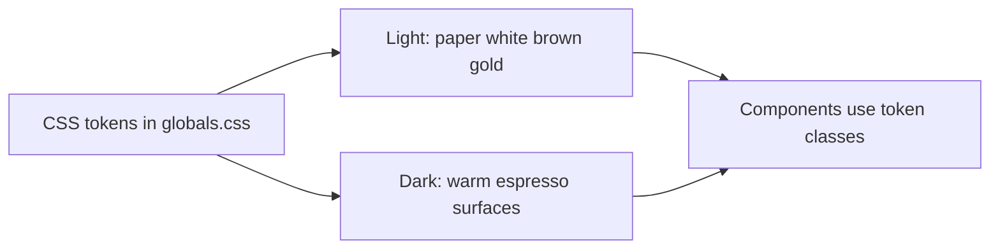

# Frontend theme and color improvements

Keep the existing sharp, zero-radius, zero-shadow layout. Replace the chrome-yellow zinc remaps with the palette below, defined once as CSS tokens.

## Locked palette (light)

Accent is espresso brown **`#3F2A1D`**: dark enough to sit next to primary `#1C1C1C`, clearly brown (not black), and distinct from rating gold so stars stay the only warm highlight.

- Background: `#F7F5F2` — page canvas, footer, body
- Primary: `#1C1C1C` — headings, primary buttons, active nav, logo mark
- Accent: `#3F2A1D` — brand icons, focus rings, PRO badge border, secondary emphasis, hover on ghost controls
- Rating: `#F4B942` — filled stars, rating values, “your rating” highlights only
- Cards: `#FFFFFF` — panels, modals, inputs, navbar
- Secondary text: `#6B6B6B` — captions, placeholders, meta, footer copy
- Borders: `#E5E1DC` — all 1px edges, dividers, input outlines

Supporting (derived, not extra brand colors):

- Accent hover / muted fill: `#5C4033` on dark-on-light, `#EDE8E2` for chip/hover surfaces on the canvas
- Empty stars: `#E5E1DC`
- Danger / success stay semantic (`red-700` / `emerald-600`) on white or `#EDE8E2` — never on mustard

## Dark counterparts (same roles)

Warm, not cold zinc:

- Background: `#161412`
- Primary / inverted button fill: `#F7F5F2`
- Accent: `#C4A484` (brown lifted for contrast on dark)
- Rating: `#F4B942` (unchanged)
- Cards: `#1C1C1C`
- Secondary text: `#A39E98`
- Borders: `#2E2A26`

## What is going wrong today

The app has two palettes glued together:

- Light: hardcoded yellows (`#fefce8`, `#fffde7`) in [frontend/app/layout.tsx](frontend/app/layout.tsx), [frontend/components/Navbar.tsx](frontend/components/Navbar.tsx), and CSS overrides in [frontend/app/globals.css](frontend/app/globals.css).
- Dark: Tailwind zinc (`zinc-950` / `zinc-900` / `zinc-800`).

[frontend/app/globals.css](frontend/app/globals.css) only exposes `--background` and `--foreground`. Light mode remaps:

- `bg-white` → `#fffde7`
- `bg-zinc-50` → `#fef9c3`
- **`bg-zinc-100` → `#c1aa00`** (chips, banners, placeholders become muddy gold)

Amber is used for stars, nav icons, verified checks, thumbs, bookmarks, and CTAs, so accent and rating collide.

## Implementation (theme and components only)

1. **Tokens in [frontend/app/globals.css](frontend/app/globals.css)**  
   Set `:root` and `.dark` variables for the locked palette. Expose them in `@theme inline` as `--color-background`, `--color-foreground`, `--color-surface`, `--color-accent`, `--color-rating`, `--color-muted`, `--color-border`. Delete the `html:not(.dark)` zinc remaps and MapLibre yellow overrides; restyle map chrome with the same tokens.

2. **Use token classes, drop hex**  
   Replace `bg-[#fefce8]`, `bg-[#fffde7]`, `bg-white`, `bg-zinc-*`, `text-zinc-*`, `border-zinc-*`, `text-amber-*` with `bg-background`, `bg-surface`, `text-foreground`, `text-muted`, `border-border`, `text-accent`, `text-rating` / `fill-rating`. Touch layout, navbar, footer, home, login/register, stores, store-detail, dashboard, owner, profile, cards, filters, modals, map — **colors only**.

3. **Accent vs rating**  
   `#F4B942` only on `StarRating`, rating numbers, and “you rated” chips. Lucide icons in Navbar, Explore, Owner, cameras, map pins use `text-accent` or `text-muted`. Primary buttons stay `#1C1C1C` / inverted in dark. Ghost/secondary hover uses `#EDE8E2` (light) or `#2E2A26` (dark), not gold.

4. **Focus and inputs**  
   Inputs and theme toggle: `border-border`, focus `border-accent` (brown), not zinc-950 or amber. Cards and navbar: `bg-surface` on `bg-background`.

5. **Theme toggle copy**  
   Drop “Chrome Yellow” / “Monochromatic Zinc”. Light = warm paper; dark = espresso.

## Out of scope

No layout, information architecture, rounding, or shadows. The global zero-radius / zero-shadow rule stays.
