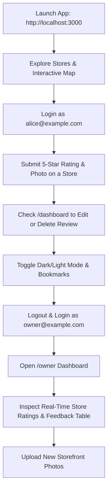

# StoreRank — Full-Stack Store Rating & Discovery Platform

[](https://nextjs.org/)
[](https://react.dev/)
[](https://nestjs.org/)
[](https://www.mongodb.com/)
[](https://tailwindcss.com/)
[](https://maplibre.org/)
[](https://vitest.dev/)
[](LICENSE)

A complete, production-ready, full-stack store discovery and community rating platform. Built with **Next.js 16 (App Router)**, **NestJS 12**, **MongoDB (Mongoose ODM)**, **Tailwind CSS v4**, and **MapLibre GL**.

StoreRank delivers a transparent, secure ecosystem where shoppers can explore verified local stores via an interactive map, browse community reviews with customer photos, submit and update 1–5 star ratings, vote on review helpfulness, and bookmark favorite locations. Store owners have access to an isolated analytics and management portal to monitor store performance, track customer sentiment, upload high-resolution store imagery, and manage business details.

---

## Table of Contents

1. [Key Highlights & Architecture Overview](#1-key-highlights--architecture-overview)
2. [Complete Feature Matrix](#2-complete-feature-matrix)
3. [Technology Stack](#3-technology-stack)
4. [System Architecture](#4-system-architecture)
5. [Directory & File Structure](#5-directory--file-structure)
6. [Database Schema & Indices](#6-database-schema--indices)
7. [Comprehensive REST API Reference](#7-comprehensive-rest-api-reference)
8. [Environment Configuration](#8-environment-configuration)
9. [Installation & Local Setup](#9-installation--local-setup)
10. [Demonstration Walkthrough & Test Credentials](#10-demonstration-walkthrough--test-credentials)
11. [Automated Testing Suite](#11-automated-testing-suite)
12. [Media Storage (AWS S3 & Local Fallback)](#12-media-storage-aws-s3--local-fallback)
13. [Password Reset & Email Delivery](#13-password-reset--email-delivery)
14. [Production Deployment Guide](#14-production-deployment-guide)
15. [License](#15-license)

---

## 1. Key Highlights & Architecture Overview

- **Interactive Geospatial Map (MapLibre GL)**: Browse stores seamlessly on an interactive OpenStreetMap canvas with custom category markers, clustered zoom, popup preview cards, and one-click rating modals.
- **Location Picker & Geocoding**: Store owners can visually place their shop on an interactive map or pick from preset metropolitan centers (San Francisco, New York, Seattle, Chicago, Los Angeles).
- **Social Review System**: Includes photo uploads for reviews, community upvotes/downvotes (helpful votes), and report/moderation flags.
- **Strict Role-Based Access Control (RBAC)**: Enforces distinct authorization tiers (`USER` vs `OWNER`) with Passport JWT guards, rejecting privilege escalations.
- **High-Performance MongoDB Aggregations**: Rating averages, distribution percentiles (5★ down to 1★), and owner analytics are calculated directly inside MongoDB pipelines (`$group`, `$avg`, `$lookup`).
- **Zero-Config In-Memory Database Fallback**: Automatically spins up `mongodb-memory-server` if no external database URI is configured, allowing instant local demonstration out of the box.
- **Dual-Mode Media Storage**: Seamlessly stores media locally (`/uploads`) with optional cloud migration to AWS S3 (`POST /uploads/migrate-to-s3` or `npm run migrate:s3`).
- **Resilient Email Dispatch**: Implements password reset flows via Resend API, with an automatic console logger fallback for local offline testing.
- **Theme Support & Contemporary UI**: Built with dark and light themes, monospace micro-typography, skeleton loaders, and responsive layouts for mobile, tablet, and desktop.

---

## 2. Complete Feature Matrix

### 👤 Shopper & Customer (`USER` Role)
- **Live Search & Category Filter**: Filter stores instantly across Grocery, Malls, Clothes, Electronics, and Bakery with real-time text debouncing.
- **Triple View Switcher**: Toggle seamlessly between **Grid**, **List**, and **Map** layouts on `/stores`.
- **Dedicated Store Details (`/stores/[id]`)**:
  - Full-width hero gallery with lightbox zoom.
  - Store hours schedule, parking info, website link, phone, and highlights.
  - Star distribution breakdown bar chart (5★ to 1★).
  - Public reviews filtered by rating (All, 5★, 4★, etc.) or "Reviews with Photos".
  - Similar store recommendations carousel.
- **Interactive 1–5 Star Rating & Review**:
  - 1–5 star interactive selection with review text (up to 1,000 characters).
  - Multiple customer photo uploads directly from the rating modal.
  - Truthfulness certification checkbox.
  - Conflict prevention: Automatic enforcement of 1 rating per user per store.
  - Edit or delete previously submitted ratings at any time.
- **Review Interaction**:
  - Upvote (👍 Like) and Downvote (👎 Dislike) community reviews.
  - Report / flag questionable or fraudulent reviews.
- **Personal Shopper Dashboard (`/dashboard`)**:
  - Overview of all submitted reviews with real-time search.
  - Quick-action modal to edit or withdraw reviews.
  - Bookmarked stores drawer with quick navigation.
  - Reviewer stats tracker (Reputation score, Helpful votes received, Reviewer Rank badge).
- **Profile & Account Center (`/profile`)**:
  - Manage display name, address, bio, city, phone number, and avatar URL.
  - Security tab: Change password with live complexity checklist validation.
  - Danger Zone: Self-service account deletion with confirmation safeguards.

### 🏪 Store Owner (`OWNER` Role)
- **Isolated Owner Portal (`/owner`)**:
  - Multi-store switcher for owners with multiple commercial properties.
  - Aggregate statistics: Cumulative customer reviews, real-time average store rating, and engagement index.
  - Detailed feedback audit table: Customer full name, verified email, star rating, full review text, submitted photo thumbnails, and exact timestamp.
  - Store photo management: Upload multiple storefront/interior photos directly to AWS S3 or local storage, or remove outdated images.
  - Direct links to view public store pages as seen by shoppers.
- **Store Creation & Modification**:
  - Create new stores with address, category, contact info, business hours, and highlights.
  - Visual coordinate placement using the interactive `LocationPickerMap`.

### 🛡️ Authentication & Security
- **Email & Password Authentication**: Validated with `class-validator`, bcrypt salt hashing (10 rounds), and JWT bearer tokens.
- **Password Complexity**: Requires 8–16 characters, at least one uppercase letter, and at least one special character.
- **Forgot & Reset Password**: Secure tokenized password recovery links with 15-minute expiration windows.
- **Route Protections**: Frontend middleware and route guards redirect unauthenticated users and guard owner-only features.

---

## 3. Technology Stack

### Frontend
- **Framework**: [Next.js 16.4 (App Router)](https://nextjs.org/)
- **Library**: [React 19](https://react.dev/)
- **Styling**: [Tailwind CSS v4](https://tailwindcss.com/)
- **Maps**: [MapLibre GL v6.15](https://maplibre.org/)
- **Icons**: [Lucide React](https://lucide.dev/)
- **HTTP Client**: Native fetch with typed API wrappers

### Backend
- **Framework**: [NestJS 12](https://nestjs.org/)
- **Runtime**: Node.js (ES Modules, TypeScript)
- **Database / ODM**: [MongoDB](https://www.mongodb.com/) / [Mongoose 9](https://mongoosejs.com/)
- **In-Memory Testing DB**: [MongoMemoryServer 11](https://github.com/nodkz/mongodb-memory-server)
- **Authentication**: Passport.js, Passport-JWT, Bcrypt
- **Validation**: `class-validator`, `class-transformer`
- **Cloud Storage**: `@aws-sdk/client-s3` (v3)
- **Testing**: [Vitest 4](https://vitest.dev/), Supertest 7

---

## 4. System Architecture

```text
                                  +---------------------------------------+
                                  |         Next.js 16 Frontend           |
                                  |    (App Router, React 19, Tailwind)   |
                                  +---------------------------------------+
                                         |                         |
                           HTTP / REST   |                         |  Map Tiles
                        (JWT Bearer Auth)|                         |  (OpenStreetMap / CARTO)
                                         v                         v
                          +-----------------------------+   +-------------------+
                          |      NestJS 12 Backend      |   |  MapLibre WebGL   |
                          |  Controllers, Services, RBAC|   +-------------------+
                          +-----------------------------+
                            /           |            \
                           /            |             \
                          v             v              v
     +-----------------------+  +---------------+  +--------------------------+
     |   MongoDB Database    |  |  AWS S3 /     |  | Resend Email API         |
     | (Atlas or In-Memory)  |  |  Local Uploads|  | (Password Reset Tokens / |
     | Mongoose Aggregations |  |  Static Files |  |  Console Simulation Log) |
     +-----------------------+  +---------------+  +--------------------------+
```

### Authorization Flow & Guards
1. **Public Routes**: Accessible by guests (`/`, `/stores`, `/stores/[id]`, `/login`, `/register`).
2. **Optional JWT Guard**: Identifies authenticated shoppers on public store routes to return personalized bookmark statuses and existing ratings.
3. **JwtAuthGuard**: Protects member endpoints (`/users/me`, `/ratings/my-ratings`, `/users/bookmarks`).
4. **RolesGuard (`@Roles('OWNER')`)**: Validates the JWT role claim before granting access to owner controllers (`/owner/dashboard`, `/stores` creation/updates, photo deletion).

---

## 5. Directory & File Structure

```text
shop-rating-platform/
├── backend/
│   ├── src/
│   │   ├── auth/                      # Authentication & Password Recovery
│   │   │   ├── dto/                   # Register, Login, ForgotPassword, ResetPassword DTOs
│   │   │   ├── guards/                # JwtAuthGuard, OptionalJwtAuthGuard
│   │   │   ├── strategies/            # Passport JWT Strategy
│   │   │   ├── auth.controller.ts     # /auth endpoints
│   │   │   ├── auth.service.ts        # Credentials verification & JWT issuing
│   │   │   └── auth.module.ts
│   │   ├── common/                    # Shared Decorators, Guards & Services
│   │   │   ├── decorators/            # @CurrentUser(), @Roles()
│   │   │   ├── guards/                # RolesGuard
│   │   │   ├── interfaces/            # UserRole enum ('USER' | 'OWNER')
│   │   │   └── services/              # MailService (Resend / Simulated email)
│   │   ├── ratings/                   # Rating, Review & Social Interactivity
│   │   │   ├── dto/                   # CreateRatingDto, UpdateRatingDto
│   │   │   ├── schemas/               # Rating Mongoose Schema (Compound unique index)
│   │   │   ├── ratings.controller.ts  # /stores/:id/ratings, /ratings/:id/vote, report
│   │   │   ├── ratings.service.ts     # Rating submission, updates, calculations
│   │   │   ├── ratings-social.service.ts # Like/Dislike votes & flagging
│   │   │   ├── ratings.formatter.ts   # Review response formatting
│   │   │   └── ratings.module.ts
│   │   ├── stores/                    # Store Management & Directory
│   │   │   ├── dto/                   # CreateStoreDto, UpdateStoreDto
│   │   │   ├── schemas/               # Store Schema (GPS coordinates, photos, hours)
│   │   │   ├── stores.controller.ts   # /stores public & owner endpoints
│   │   │   ├── owner.controller.ts    # /owner/dashboard metrics & review inspection
│   │   │   ├── stores.service.ts      # Store queries & MongoDB aggregations
│   │   │   └── stores.module.ts
│   │   ├── users/                     # User Profiles & Bookmarks
│   │   │   ├── dto/                   # UpdateProfileDto, ChangePasswordDto
│   │   │   ├── schemas/               # User Schema (Profile, bio, bookmarks)
│   │   │   ├── users.controller.ts    # /users/me, /users/bookmarks, /users/dashboard-stats
│   │   │   ├── users.service.ts       # Profile updates, password changes, stats
│   │   │   └── users.module.ts
│   │   ├── uploads/                   # Media Storage Module
│   │   │   ├── uploads.controller.ts  # POST /uploads, GET /uploads/:filename
│   │   │   ├── uploads.service.ts     # S3 uploading & local fallback file handling
│   │   │   └── uploads.module.ts
│   │   ├── seed/                      # Auto-seed service on application boot
│   │   │   ├── seed.service.ts        # Seeds 1 Owner, 2 Users, 5 Stores, 7 Reviews
│   │   │   └── seed.module.ts
│   │   ├── scripts/
│   │   │   └── migrate-uploads.js     # Script to migrate local uploads to AWS S3
│   │   ├── app.module.ts              # Root module configuring Mongoose & ConfigModule
│   │   └── main.ts                    # Application bootstrapper with global validation pipe
│   ├── test/                          # Comprehensive Test Suites
│   │   ├── platform.spec.ts           # 24+ acceptance criteria tests
│   │   └── app.e2e-spec.ts
│   ├── .env.example
│   ├── package.json
│   ├── tsconfig.json
│   └── vitest.config.ts
│
└── frontend/
    ├── app/
    │   ├── layout.tsx                 # Root layout with AuthProvider & Navbar
    │   ├── globals.css                # Tailwind CSS v4 variables & custom styles
    │   ├── page.tsx                   # Landing page with Top Rated Stores & CTA
    │   ├── discover/page.tsx          # Fast redirect to store explorer
    │   ├── stores/
    │   │   ├── page.tsx               # Store directory with Grid, List & MapLibre map
    │   │   └── [id]/page.tsx          # Full store details, hero, breakdown & reviews
    │   ├── login/page.tsx             # Authentication login page
    │   ├── register/page.tsx          # Dual registration for Shoppers and Store Owners
    │   ├── forgot-password/page.tsx   # Request password reset link
    │   ├── reset-password/page.tsx    # Reset password with token validation
    │   ├── dashboard/page.tsx         # Shopper ratings management & bookmark center
    │   ├── owner/page.tsx             # Store owner dashboard & analytics portal
    │   └── profile/page.tsx           # Profile editor, password change, account deletion
    ├── components/
    │   ├── Navbar.tsx                 # Responsive header with theme toggle & user dropdown
    │   ├── ThemeToggle.tsx            # Dark/light mode switcher
    │   ├── StarRating.tsx             # Interactive 1–5 star selection component
    │   ├── StoreCard.tsx              # Grid & list store preview card with badge tags
    │   ├── StoreFilters.tsx           # Live search bar, category pills & sort dropdown
    │   ├── StoreMap.tsx               # Interactive MapLibre GL map view with markers
    │   ├── LocationPickerMap.tsx      # Map coordinate selector with preset cities
    │   ├── RatingModal.tsx            # Modal for adding/updating reviews & photos
    │   ├── ReviewsModal.tsx           # Community reviews modal
    │   ├── Skeleton.tsx               # Loading skeleton placeholders
    │   └── store-detail/              # Modular store detail components
    │       ├── StoreHero.tsx          # Store header with gallery banner
    │       ├── StoreAboutCard.tsx     # Description & highlights
    │       ├── StoreRatingBreakdown.tsx # Aggregated 1–5 star percentage bars
    │       ├── StoreUserReviewForm.tsx# Inline review & photo submission form
    │       ├── StoreReviewsList.tsx   # Paginated/filterable reviews with votes & flags
    │       ├── StorePhotoGallery.tsx  # Customer and owner photo grid
    │       ├── StoreSidebarInfo.tsx   # Operating hours, address, phone & map card
    │       └── StoreLightbox.tsx      # Fullscreen image viewer
    ├── context/
    │   └── AuthContext.tsx            # Global auth state, token storage, user info
    ├── lib/
    │   ├── api.ts                     # Unified API instance exporting typed sub-APIs
    │   └── api/                       # Modular REST clients (auth, stores, ratings, users, uploads, owner)
    ├── types/
    │   └── index.ts                   # TypeScript interfaces (Store, Rating, User, Stats)
    ├── public/
    │   └── maplibre-gl-worker.mjs     # Web worker for fast MapLibre vector tile rendering
    ├── .env.example
    ├── package.json
    └── tsconfig.json
```

---

## 6. Database Schema & Indices

### 1. User Schema (`users`)
```typescript
{
  _id: ObjectId,
  name: string,                 // 5–60 characters, trimmed
  email: string,                // Unique, lowercase, trimmed (Indexed)
  address: string,              // Max 400 characters, trimmed
  passwordHash: string,         // Bcrypt hash (10 rounds)
  role: 'USER' | 'OWNER',       // Role enum, default: 'USER'
  bookmarks: string[],          // Array of store ObjectIds
  bio?: string,                 // Max 300 characters
  phone?: string,               // Max 20 characters
  city?: string,                // Max 100 characters
  avatarUrl?: string,           // Image URL
  resetPasswordToken?: string,  // Select: false (Security token)
  resetPasswordExpires?: Date,  // Select: false (15-minute expiration)
  createdAt: Date,
  updatedAt: Date
}
```

### 2. Store Schema (`stores`)
```typescript
{
  _id: ObjectId,
  name: string,                 // 2–100 characters, trimmed
  address: string,              // Max 400 characters, trimmed
  ownerId: ObjectId,            // References User._id (Indexed)
  category: string,             // Grocery, Malls, Clothes, Electronics, Bakery (Indexed)
  latitude: number,             // GPS latitude, default: 40.7128
  longitude: number,            // GPS longitude, default: -74.0060
  photos: string[],             // Array of store image URLs
  description?: string,         // Detailed store narrative
  phone?: string,               // Store phone number
  website?: string,             // Store website URL
  openingHours?: string,        // e.g. "Mon-Sat: 08:00 AM - 09:00 PM"
  schedule?: Record<string, string>, // Detailed day-by-day hours
  highlights?: Array<{ title: string; description: string }>,
  parkingInfo?: string,         // Parking availability description
  supportEmail?: string,        // Store support email
  merchantNotice?: string,      // Promotional banner or special alert
  createdAt: Date,
  updatedAt: Date
}
// Indices:
// - Text index on { name: 'text', address: 'text' }
// - Single index on ownerId
// - Single index on category
```

### 3. Rating Schema (`ratings`)
```typescript
{
  _id: ObjectId,
  userId: ObjectId,             // References User._id (Indexed)
  storeId: ObjectId,            // References Store._id (Indexed)
  rating: number,               // Integer 1–5 (Validated)
  review?: string,              // Review commentary (Max 1,000 characters)
  photos: string[],             // Uploaded customer photo URLs
  likes: ObjectId[],            // Array of User IDs who voted "Helpful"
  dislikes: ObjectId[],         // Array of User IDs who voted "Unhelpful"
  reports: Array<{              // Moderation flags
    userId: ObjectId,
    reason: string,
    createdAt: Date
  }>,
  createdAt: Date,
  updatedAt: Date
}
// Compound Unique Index:
// { userId: 1, storeId: 1 } -> Prevents duplicate ratings for the same store by one user
```

---

## 7. Comprehensive REST API Reference

All requests and responses use JSON format. Authenticated endpoints require the header:  
`Authorization: Bearer <access_token>`

### 🔐 Authentication (`/auth`)

| Method | Endpoint | Description | Auth Required |
|---|---|---|---|
| `POST` | `/auth/register` | Register a new customer (`USER`) or store owner (`OWNER`) | No |
| `POST` | `/auth/login` | Authenticate with email & password to receive a JWT | No |
| `POST` | `/auth/forgot-password` | Request a password reset link sent via email | No |
| `POST` | `/auth/reset-password` | Reset password using a valid reset token | No |
| `GET` | `/auth/me` | Fetch profile details of the authenticated user | Bearer Token |
| `POST` | `/auth/logout` | Client session termination | Bearer Token |

#### Registration Payload Example (`POST /auth/register`)
```json
{
  "name": "Alex Montgomery",
  "email": "alex@example.com",
  "password": "Password@123",
  "address": "456 Mission Street, Suite 300, San Francisco, CA",
  "role": "USER"
}
```

---

### 🏬 Stores (`/stores`)

| Method | Endpoint | Description | Auth Required |
|---|---|---|---|
| `GET` | `/stores` | Get all stores with aggregated ratings, search & category filters | Optional |
| `GET` | `/stores/:id` | Get single store details, user rating status, and metadata | Optional |
| `GET` | `/stores/:id/gallery` | Get combined owner & customer photos for store | No |
| `POST` | `/stores` | Create a new store (GPS coordinates, category, hours) | `OWNER` only |
| `PUT` | `/stores/:id` | Update store information and settings | `OWNER` only |
| `POST` | `/stores/:id/photos` | Upload photos to a store gallery | Authenticated |
| `DELETE` | `/stores/:id/photos` | Remove a photo from a store | `OWNER` only |

#### Query Parameters for `GET /stores`
- `search`: Case-insensitive text search across store name and address (e.g. `?search=market`).
- `category`: Filter by category (e.g. `?category=Grocery`).

---

### ⭐ Ratings & Reviews (`/stores/:storeId/ratings`, `/ratings`)

| Method | Endpoint | Description | Auth Required |
|---|---|---|---|
| `POST` | `/stores/:storeId/ratings` | Submit a 1–5 star rating, optional review text, and photos | `USER` only |
| `PATCH` | `/stores/:storeId/ratings` | Update previously submitted rating and review | `USER` only |
| `DELETE` | `/stores/:storeId/ratings` | Delete user's rating for the store | `USER` only |
| `GET` | `/stores/:storeId/ratings/me` | Retrieve the authenticated user's current rating for store | `USER` only |
| `GET` | `/stores/:storeId/reviews` | Get public community reviews with upvote counts and photos | Optional |
| `GET` | `/ratings/my-ratings` | Get all ratings submitted by the logged-in user | Authenticated |
| `POST` | `/ratings/:id/vote` | Vote on review helpfulness (`{ "type": "LIKE" \| "DISLIKE" }`) | Authenticated |
| `POST` | `/ratings/:id/report` | Report / flag a review (`{ "reason": "Spam" }`) | Authenticated |

#### Rating Submission Payload (`POST /stores/:storeId/ratings`)
```json
{
  "rating": 5,
  "review": "Incredible fresh produce and friendly staff. Love the bulk pantry section!",
  "photos": [
    "http://localhost:5000/uploads/store-photo-1.jpg"
  ]
}
```

---

### 👤 Users & Bookmarks (`/users`)

| Method | Endpoint | Description | Auth Required |
|---|---|---|---|
| `GET` | `/users/me` | Get complete user profile information | Authenticated |
| `PATCH` | `/users/profile` | Update user name, address, bio, city, phone, and avatar | Authenticated |
| `PATCH` | `/users/change-password` | Update account password (verifies current password) | Authenticated |
| `DELETE` | `/users/me` | Permanently delete account and associated ratings | Authenticated |
| `GET` | `/users/dashboard-stats` | Get reviewer statistics (reputation score, rank badge) | Authenticated |
| `GET` | `/users/bookmarks` | Get list of user's bookmarked stores | Authenticated |
| `POST` | `/users/bookmarks/:storeId` | Toggle bookmark status for a store | Authenticated |

---

### 📊 Owner Portal (`/owner`)

| Method | Endpoint | Description | Auth Required |
|---|---|---|---|
| `GET` | `/owner/dashboard` | List owned stores, cumulative stats, and customer feedback | `OWNER` only |

---

### 📁 Media Uploads (`/uploads`)

| Method | Endpoint | Description | Auth Required |
|---|---|---|---|
| `POST` | `/uploads` | Upload up to 10 image files (`multipart/form-data`) | Authenticated |
| `POST` | `/uploads/single` | Upload a single image file (`multipart/form-data`) | Authenticated |
| `GET` | `/uploads/:filename` | Stream uploaded image file or redirect to S3 | Public |
| `POST` | `/uploads/migrate-to-s3` | Migrate all locally uploaded files to AWS S3 | `OWNER` / Admin |

---

## 8. Environment Configuration

### Backend (`backend/.env`)

Create `backend/.env` (or copy from `backend/.env.example`):

```bash
# Server Configuration
PORT=5000
FRONTEND_URL=http://localhost:3000

# Database Configuration (Optional: Omit to use zero-config in-memory MongoDB)
MONGODB_URI=mongodb://localhost:27017/shop-rating-platform

# Authentication
JWT_SECRET=super-secret-jwt-development-token-key-32-chars-min
JWT_EXPIRES_IN=7d

# Cloud Storage: AWS S3 (Optional: Uploads use local storage if omitted)
AWS_ACCESS_KEY_ID=
AWS_SECRET_ACCESS_KEY=
AWS_REGION=us-east-1
AWS_S3_BUCKET=

# Transactional Emails: Resend (Optional: Simulates & logs reset links to console if omitted)
RESEND_API_KEY=
EMAIL_FROM=StoreRank <onboarding@resend.dev>
```

> **Zero-Config Developer Experience**: If `MONGODB_URI` is left blank, the backend automatically initializes an in-memory database using `mongodb-memory-server` and seeds it instantly. No local MongoDB installation required!

### Frontend (`frontend/.env.local`)

Create `frontend/.env.local` (or copy from `frontend/.env.example`):

```bash
# Backend REST API Endpoint
NEXT_PUBLIC_API_URL=http://localhost:5000
```

---

## 9. Installation & Local Setup

### Prerequisites
- **Node.js**: v18.x, v20.x, or v22.x
- **npm**: v9.x or higher

### 1. Clone the Repository
```bash
git clone https://github.com/your-username/shop-rating-platform.git
cd shop-rating-platform
```

### 2. Set Up the Backend
```bash
cd backend
npm install
cp .env.example .env
```

Start the backend in development mode:
```bash
npm run start:dev
```
The backend will launch at `http://localhost:5000`. On first boot, demonstration data will be seeded automatically.

### 3. Set Up the Frontend
Open a new terminal:
```bash
cd frontend
npm install
cp .env.example .env.local
```

Start the frontend in development mode:
```bash
npm run dev
```
The frontend application will be live at `http://localhost:3000`.

---

## 10. Demonstration Walkthrough & Test Credentials

The database automatically seeds test accounts and stores with realistic reviews and imagery.

### Pre-Configured Test Accounts

| Role | Email | Password | Description |
|---|---|---|---|
| **Store Owner** (`OWNER`) | `owner@example.com` | `Password@123` | Master owner account managing 5 stores in San Francisco |
| **Shopper One** (`USER`) | `alice@example.com` | `Password@123` | Active shopper with 4 submitted reviews |
| **Shopper Two** (`USER`) | `bob@example.com` | `Password@123` | Active reviewer with 3 submitted reviews |

*(All passwords meet strict complexity: 8–16 characters, 1+ uppercase letter, 1+ special character).*

---

### Step-by-Step Demonstration Flow



1. **Guest Discovery**:
   - Open `http://localhost:3000/stores`.
   - Toggle view modes between **Grid**, **List**, and **Map**.
   - Use the category bar to filter by **Grocery** or **Bakery**.
   - Try the interactive map: Click any store marker pin to open the preview modal.
2. **Shopper Rating Experience**:
   - Log in using `alice@example.com` / `Password@123`.
   - Click on **Sunrise Artisan Bakery & Cafe** (`/stores/[id]`).
   - View the star rating breakdown and community reviews.
   - Click **Rate Store** to open the modal, select 5 stars, write a comment, and attach a photo.
   - Upvote Bob's helpful review by clicking the 👍 icon.
3. **Shopper Management Center**:
   - Navigate to `/dashboard` to view your submitted reviews.
   - Click **Edit Review** to update your rating from 5★ to 4★ and observe the instant average recalculation.
   - Click the bookmark icon on any store to save it to your bookmarks drawer.
4. **Owner Analytics & Control**:
   - Log out and log in with `owner@example.com` / `Password@123`.
   - Click **Owner Portal** in the navigation bar (`/owner`).
   - Switch between owned stores using the dropdown selector.
   - Inspect the feedback table containing customer names, emails, star scores, and review dates.
   - Upload new photos directly to the store photo gallery.

---

## 11. Automated Testing Suite

The backend includes a comprehensive test suite written in **Vitest** and **Supertest**, verifying all 24 acceptance criteria against an isolated in-memory MongoDB instance:

- **Authentication**: Registration validations (name length, email format, address length, password complexity), duplicate email rejection (400), login token generation, password mismatch checks.
- **Store Directory & Filtering**: Case-insensitive text searches, category filtering, public access without token, optional auth integration.
- **Rating Lifecycle**: 1–5 integer rating constraints, rejection of non-integer values, conflict detection on duplicate ratings (409 Conflict), in-place rating updates (PATCH), deletion.
- **RBAC & Security**: Prevention of non-owners accessing `/owner/dashboard` (403 Forbidden), isolation of store data between different owners, token verification.

### Run Tests
```bash
cd backend
npm test
```

### Run Tests in Watch Mode
```bash
cd backend
npm run test:watch
```

### Run Tests with Coverage Report
```bash
cd backend
npm run test:cov
```

---

## 12. Media Storage (AWS S3 & Local Fallback)

StoreRank provides a plug-and-play storage architecture:

1. **Local Mode (Default)**: If AWS credentials are not specified in `.env`, uploaded files are saved to the local `backend/uploads/` directory and served via `GET /uploads/:filename`.
2. **AWS S3 Mode**: If `AWS_ACCESS_KEY_ID`, `AWS_SECRET_ACCESS_KEY`, and `AWS_S3_BUCKET` are provided, uploads are automatically pushed to your S3 bucket.
3. **One-Command Cloud Migration**: Migrate local assets to AWS S3 at any time:
   ```bash
   cd backend
   npm run migrate:s3
   ```
   Or trigger it via HTTP:
   ```bash
   POST http://localhost:5000/uploads/migrate-to-s3
   ```

---

## 13. Password Reset & Email Delivery

1. User requests a reset on `/forgot-password`.
2. Backend generates a cryptographically secure random token with a 15-minute expiry.
3. If `RESEND_API_KEY` is present, a branded HTML email is dispatched to the user's inbox.
4. If `RESEND_API_KEY` is omitted, the link is logged cleanly to the backend console:
   ```text
   ========================================================
   [SIMULATED EMAIL TO: alice@example.com]
   Subject: StoreRank Password Reset Request
   Reset Link: http://localhost:3000/reset-password?token=...
   ========================================================
   ```
5. Visiting the link permits the user to enter and confirm their new password.

---

## 14. Production Deployment Guide

### Deploy Backend on [Render](https://render.com)
1. Create a new **Web Service** on Render and link your GitHub repository.
2. Set configuration:
   - **Root Directory**: `backend`
   - **Build Command**: `npm install && npm run build`
   - **Start Command**: `npm run start:prod`
3. Configure Environment Variables in Render:
   - `PORT`: `5000`
   - `MONGODB_URI`: `mongodb+srv://<user>:<password>@cluster.mongodb.net/storerank?retryWrites=true&w=majority`
   - `JWT_SECRET`: `<generate-a-strong-random-secret>`
   - `JWT_EXPIRES_IN`: `7d`
   - `FRONTEND_URL`: `https://your-storerank-frontend.vercel.app`
   - *(Optional)* `AWS_ACCESS_KEY_ID`, `AWS_SECRET_ACCESS_KEY`, `AWS_S3_BUCKET`, `AWS_REGION`
   - *(Optional)* `RESEND_API_KEY`, `EMAIL_FROM`

### Deploy Frontend on [Vercel](https://vercel.com)
1. Import your repository into Vercel.
2. Set configuration:
   - **Root Directory**: `frontend`
   - **Framework Preset**: Next.js
3. Add Environment Variable:
   - `NEXT_PUBLIC_API_URL`: `https://your-backend-api.onrender.com`
4. Click **Deploy**.

### MongoDB Atlas Setup
1. Create a free M0 cluster at [MongoDB Atlas](https://www.mongodb.com/cloud/atlas).
2. Under **Network Access**, add `0.0.0.0/0` (Allow access from anywhere).
3. Under **Database Access**, create a user with read/write permissions.
4. Obtain the connection string and paste it into the `MONGODB_URI` environment variable on Render.

---

## 15. License

Distributed under the MIT License. See `LICENSE` for more information.
